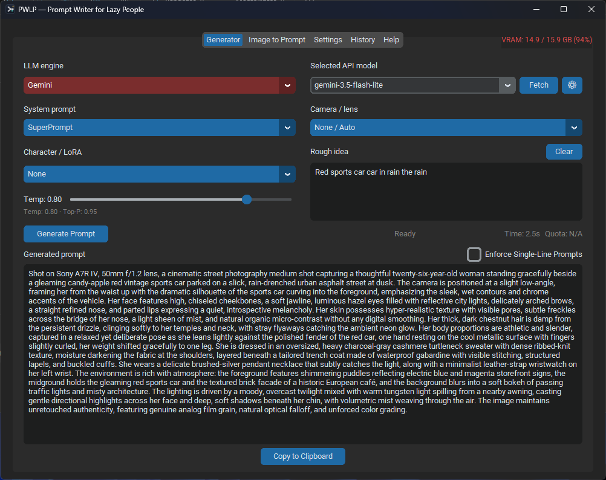

# PWLP — Prompt Writer for Lazy People

PWLP (internally `promptwriter`) is a free Windows desktop app that turns a
rough idea into a detailed English prompt, and can analyze a reference image to
produce an image-generation prompt. It works with Google Gemini, Groq, or a
local [LM Studio](https://lmstudio.ai/) server.




## Features

- **Generator** — expand a rough idea into a prompt using a selected system
  prompt, optional camera/lens keywords, and an optional Character / LoRA
  profile that forces trigger words at the start.
- **Image to Prompt** — analyze a dropped or selected image and generate a
  prompt, optionally replacing the person's appearance with a saved character
  profile while keeping pose, clothing, and scene.
- **Engines** — Gemini, Groq, or Local (LM Studio), with model fetching and
  per-model sampling profiles (temperature, Top-P, Presence Penalty, Max
  Tokens, and Local-only Min-P, Repeat Penalty, Context Length, Disable
  Thinking).
- **History** — searchable, favoritable log of past generations with bulk
  delete and favorite export.
- **VRAM monitor** — live GPU 0 memory usage and a Local-generation pre-flight
  that can offer to unload ComfyUI / Forge Neo models. **NVIDIA GPUs only.**
- **Personal data reset** — one action in Settings deletes your settings,
  profiles, custom prompts, history, and caches while restoring the three
  baseline system prompts.

## Requirements

- Windows 10/11 (developed and tested on Windows).
- Python 3.10 or newer (tested with Python 3.13).
- One of: LM Studio running a local model, a Gemini API key, or a Groq API key.
- An NVIDIA GPU is optional; it only enables the live VRAM monitor.

## Setup

```bat
python -m venv venv
venv\Scripts\activate
pip install -r requirements.txt
python main.py
```

## Using LM Studio (local, offline)

1. Install [LM Studio](https://lmstudio.ai/) and download a chat model.
2. Start the local server (default `http://127.0.0.1:1234`).
3. In PWLP open **Settings**, keep the LM Studio base URL, click
   **Save Settings**, then choose **Local (LM Studio)** as the engine and use
   **Fetch** to load the model list.

## Using Gemini or Groq (cloud)

- Create a free key at [Google AI Studio](https://aistudio.google.com/) or the
  [Groq console](https://console.groq.com/).
- Paste it into **Settings** under the matching API key field, click
  **Save Settings**, then select Gemini or Groq as the engine.
- Cloud engines do not need LM Studio and can be used alongside local models.

API keys are stored in plain text in `config.json` in the app folder. That file
is gitignored — do not commit or share it.

## VRAM monitor

The header shows live GPU 0 memory usage on NVIDIA GPUs via NVML. On non-NVIDIA
GPUs, or when no NVIDIA driver is available, it shows `VRAM: Not supported` and
the VRAM pre-flight is skipped. When a Local generation starts with VRAM above
50% and no model loaded, PWLP can offer to unload ComfyUI / Forge Neo models
first.

## Personal data

**Settings → Reset / Delete All Personal Data** permanently deletes settings and
model profiles, LoRA and camera entries, custom system prompt files, history,
the rough-idea cache, and cached model lists, then restores the three baseline
prompts. A separate checkbox also deletes saved API keys. Keep your own copies of
anything important.

## Tests

```bat
venv\Scripts\python.exe -m unittest discover -s tests
```

## Building a Windows executable

PyInstaller is a build-time dependency (not needed to run from source):

```bat
pip install pyinstaller
pyinstaller --noconfirm --clean pwlp.spec
```

The onedir build is written to `dist\PWLP\PWLP.exe`. The spec bundles the
TkDND native files from tkinterdnd2 (drag-and-drop), CustomTkinter data,
`promptwriter/assets/`, and `defaults/`, plus the Tcl/Tk, SQLite, and ctypes
runtime DLLs used by the Python installation. `build/` and `dist/` are
gitignored. On first launch the app creates its `config.json`, `data/`, and
system prompt folders inside `dist\PWLP\_internal`.

## Support

PWLP is 100% free with no limits or paid tiers. Supporting development on Ko-fi is completely voluntary and does not unlock any extra features or perks — if it is useful to you, you can support the project here: https://ko-fi.com/promptwriter

## Troubleshooting & Support Policy

PWLP is a personal hobby project. I am not a professional developer and cannot provide individual technical support, installation help, or bug fixes.

If you run into any installation issues or errors, please ask an AI assistant (like ChatGPT, Gemini, or Claude) — they're much better at troubleshooting than I am!

## License and disclaimer

PWLP is released under the [MIT License](LICENSE) and is distributed **as-is**,
without warranty of any kind. You are responsible for the prompts and images it
produces and for complying with the terms of the providers you use. The author
accepts no liability for outputs, third-party services, API costs, or data loss.

Third-party licenses and notices are documented in
[THIRD_PARTY_NOTICES.md](THIRD_PARTY_NOTICES.md). LM Studio, Gemini, and Groq are
third-party names used only to describe compatibility; PWLP is not affiliated
with, endorsed by, or sponsored by their owners. See the in-app
**Help → License & Disclaimer** tab for the same information.

Use PWLP at your own risk.
